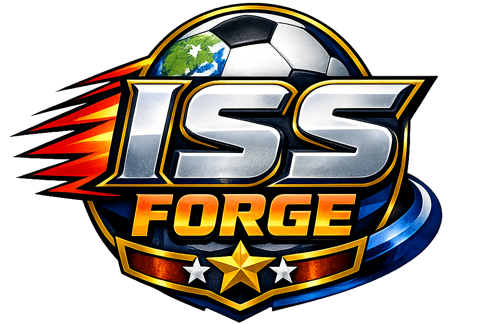
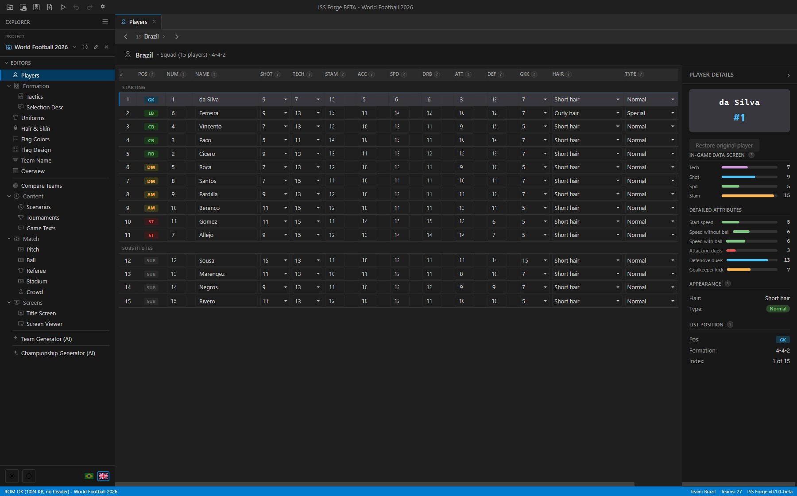
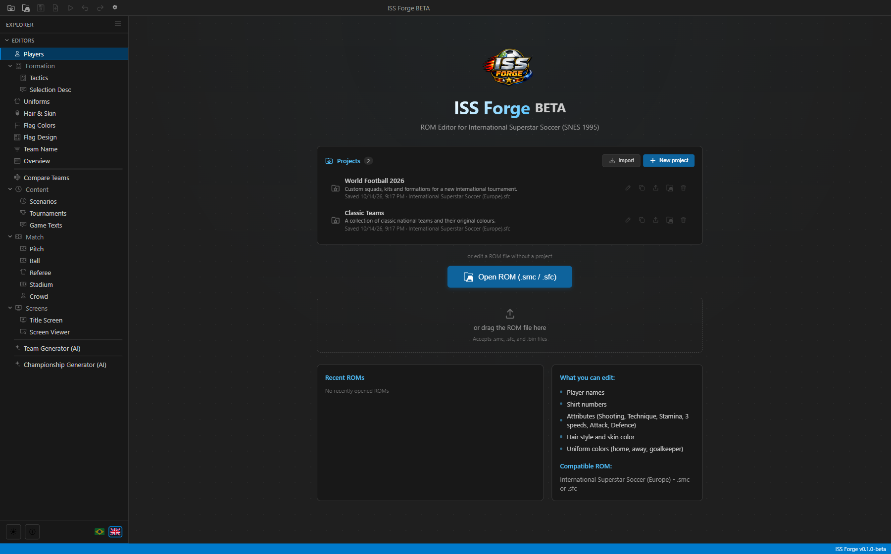
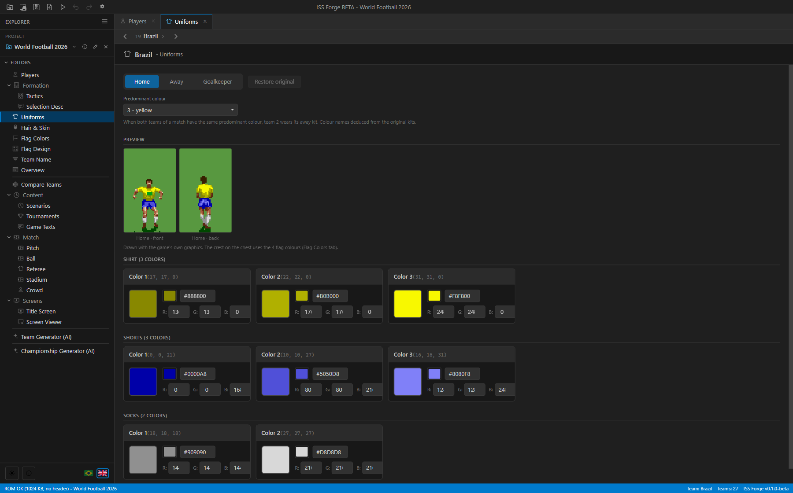
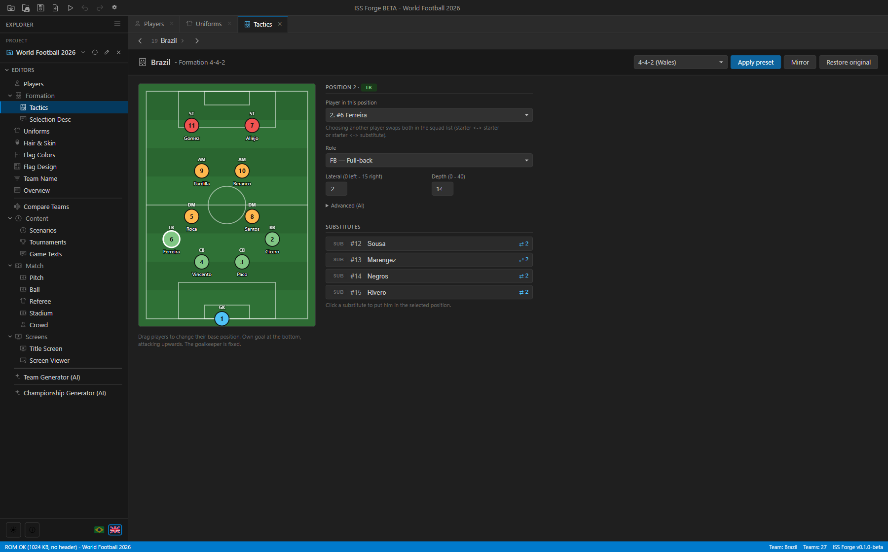
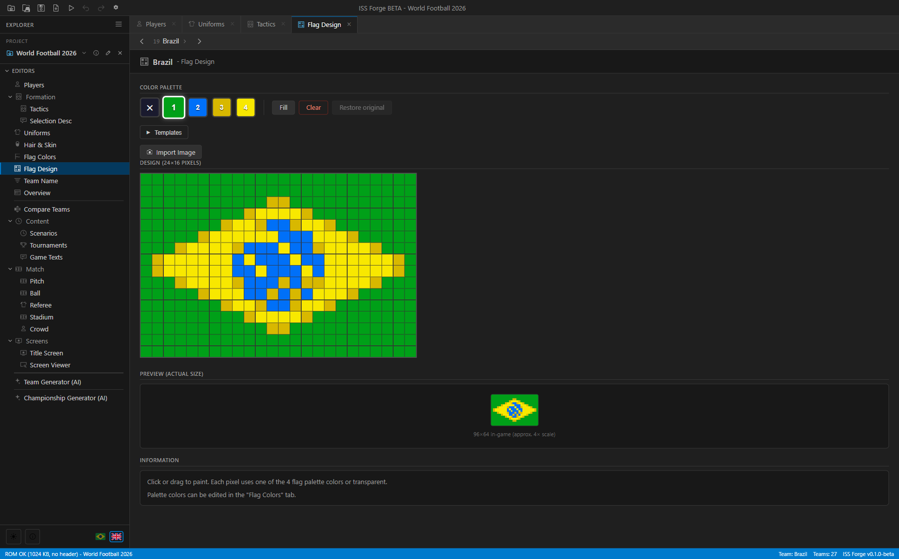
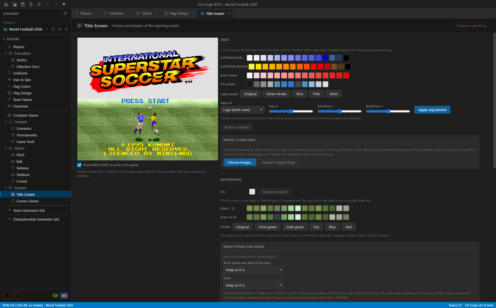
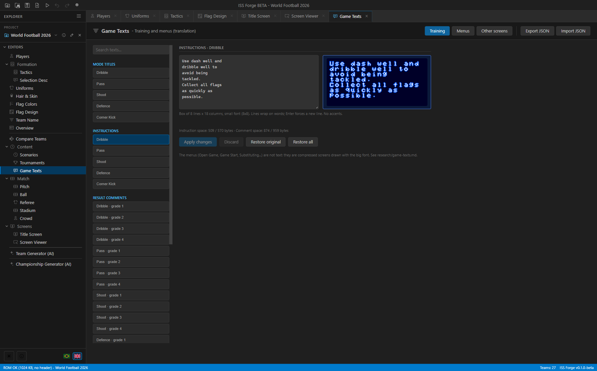
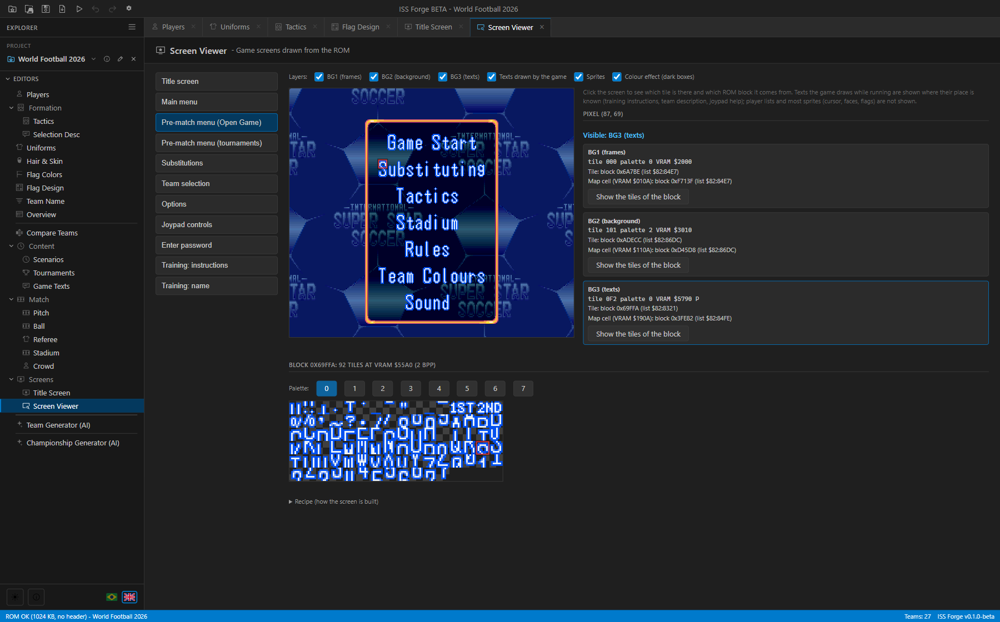

<p align="center">
  
</p>

<h1 align="center">ISS Forge</h1>

<p align="center">


</p>

**Visual ROM Editor for International Superstar Soccer (SNES, 1995)**

ISS Forge is a visual ROM editor for International Superstar Soccer on the Super Nintendo. It allows you to customize teams, players, uniforms, flags and more through an intuitive interface.

## Screenshots

Captured from the desktop app. Click any image to view it at full resolution.

<table>
  <tr>
    <td width="50%" align="center">
      <strong>Players &amp; detailed attributes</strong><br />
      <a href="screenshots/players.png"></a>
    </td>
    <td width="50%" align="center">
      <strong>Projects &amp; session management</strong><br />
      <a href="screenshots/projects.png"></a>
    </td>
  </tr>
  <tr>
    <td width="50%" align="center">
      <strong>Uniform colours &amp; live previews</strong><br />
      <a href="screenshots/uniforms.png"></a>
    </td>
    <td width="50%" align="center">
      <strong>Formation &amp; lineup</strong><br />
      <a href="screenshots/formation.png"></a>
    </td>
  </tr>
  <tr>
    <td width="50%" align="center">
      <strong>Flag design</strong><br />
      <a href="screenshots/flag-design.png"></a>
    </td>
    <td width="50%" align="center">
      <strong>Title screen customisation</strong><br />
      <a href="screenshots/title-screen.png"></a>
    </td>
  </tr>
  <tr>
    <td width="50%" align="center">
      <strong>Game texts &amp; translation</strong><br />
      <a href="screenshots/game-texts.png"></a>
    </td>
    <td width="50%" align="center">
      <strong>Screen viewer &amp; tile inspector</strong><br />
      <a href="screenshots/screen-viewer.png"></a>
    </td>
  </tr>
</table>

---

## Features

- **Players** — Edit names, shirt numbers and every attribute in the ROM: shooting, technique, stamina, start speed, speed without/with the ball, attacking/defensive duels and goalkeeper kick (the SPEED bar is computed like the game does)
- **Formation & Lineup** — Edit each team's default formation stored in the ROM (drag positions on a pitch, roles, 9 presets taken from original teams) and swap starters/substitutes
- **Scenarios** — Edit the 9 Scenario mode challenges: teams, score, clocks and intro text (with an 8×23 screen preview)
- **Tournaments** — Edit the 32 International Cup / World Series draws (6 groups of 4), with a guard against the freeze caused by a team missing from every draw
- **Game Texts** — Translate the training mode texts and the texts of 19 menu screens (pre-match menu, rules, options...), with box previews and a space check. Export/import all texts as one JSON file for translation
- **Pitch & Ball** — Recolour the pitch for every type (A/B/C) and weather (sunny/rain/snow), the ball and the referee/linesmen kit, with presets and hue/saturation/brightness tools
- **Title Screen** — Recolour the logo, brush stroke, sky, grass and texts of the opening screen, pick the teams, poses and positions of the two players, move or hide the ball and the shadows, translate the copyright lines and PRESS START, import a new logo from an image (PNG), and remove or replace the brush stroke and the grass with images, with a live preview drawn from the ROM
- **Screen Viewer** — See 10 menu screens and the title screen drawn from the ROM as it is now (frames, background, texts, colour effects), toggle layers, click a pixel to see its tile, palette and the ROM block it comes from, and browse that block's tiles
- **Stadium & Crowd** — Recolour the perimeter wall/goal net and photographers, edit the 20 crowd palettes and choose which one each team's fans use
- **Team Descriptions** — Edit the selection-screen text ("Offensive 4-4-2" + description) with a 15×8 preview, kept in sync with the formation
- **Copy / Swap Teams** — Move a whole team (players, hidden attributes, kits, flag, names, formation, description, crowd) to another slot
- **Test in Emulator** — One click (F5) runs the current ROM in your emulator (RetroArch, bsnes, snes9x, Mesen…) from a temporary file
- **Hair & Skin** — Customize hair style and skin color (normal and special players)
- **Uniforms** — Full color editor (shirt, shorts, socks, goalkeeper) with real-time preview
- **Flags** — Pixel-by-pixel design editor + palette colors (4 indexed colors)
- **Flag Templates** — Library of ready-made templates + image import
- **Team Names** — Rename teams with automatic tile generation (scoreboard + selection screen)
- **Overview** — Visualize the full team squad
- **Compare** — Compare attributes between two teams
- **AI Generator** — Generate complete teams (players, uniforms, flag) via prompt with local or cloud LLM
- **Import/Export** — Export and import team configurations as JSON
- **Patch Export** — Export your hack as a BPS (recommended, CRC32-validated) or IPS patch, against the opened ROM or any clean base ROM
- **Auto Checksum** — SNES internal checksum/complement is recalculated automatically on save and patch export
- **Auto-update** — Automatic updates via GitHub Releases
- **Auto-backup** — Backup every minute while editing, atomic saves and session recovery
- **Undo/Redo** — Undo and redo changes
- **Themes** — Light and dark mode
- **Internationalization** — Portuguese (pt-BR) and English

## Download

Head to the [Releases](../../releases) page to download the latest version for your OS:

- **Windows** — `.exe` (NSIS installer)
- **macOS** — `.dmg`
- **Linux** — `.AppImage` / `.deb`

## Development

### Requirements

- Node.js 20+
- npm

### Setup

```bash
# Clone the repository
git clone https://github.com/leandrolsouza/iss-forge.git
cd iss-forge

# Install dependencies
npm install

# Development mode (web only)
npm run dev

# Development mode (Electron + Vite)
npm run electron:dev
```

### Commands

```bash
# Web build
npm run build

# Electron build (generates installer)
npm run electron:build

# Tests (single run)
npm test

# Tests (watch mode)
npm run test:watch

# Lint
npm run lint
npm run lint:fix

# Format
npm run format
npm run format:check
```

## Compatible ROMs

- International Superstar Soccer (Europe), 1 MB — `.smc` / `.sfc` files, with or without a 512-byte copier header
- Hacks and translations that preserve the supported European engine and pointer layout

Compatibility is checked using engine signatures and internal pointers, rather than the title alone. Other versions (including the Japanese release) and expanded/relocated layouts are rejected until their offsets are verified. Modified titles and checksums remain supported when the layout matches.

## Tech Stack

| Technology | Usage |
|------------|-------|
| Electron 44 | Cross-platform desktop app |
| React 19 | User interface |
| Vite 8 | Build tooling |
| Vitest 5 | Unit testing |
| ESLint 9 | Linter (flat config) |
| Prettier 3 | Code formatting |
| electron-builder | Packaging |
| electron-updater | Auto-update |
| SNES 4bpp | Tile graphics decoding |
| Konami LZ | Data compression/decompression |

## Architecture

```
iss-forge/
├── electron/          # Electron main process (ES modules)
├── src/
│   ├── components/    # React components (editors and panels)
│   ├── context/       # RomContext — central ROM state
│   ├── hooks/         # Custom hooks (useRomState, useRomHandlers)
│   ├── rom/           # ROM parsing/writing logic (pure JS, no React)
│   │   ├── readers/   # Read specific data from ROM buffer
│   │   ├── writers/   # Write modified data back to ROM buffer
│   │   └── __tests__/ # Unit tests for ROM logic
│   ├── services/      # Abstraction over Electron IPC
│   ├── utils/         # Generic helpers
│   ├── i18n/          # Locale files (en, pt-BR)
│   ├── theme/         # Theme provider (light/dark)
│   └── styles/        # CSS (one file per component)
├── research/          # Technical documentation (ROM maps, findings, backlog)
└── game-translations/ # Exported texts (EN) and the PT-BR translation
```

- Electron ↔ React communication via IPC with context bridge
- ROM logic in `src/rom/` is pure JS — easy to unit test in isolation
- Reader/Writer pattern: each data domain has dedicated modules
- Single `RomContext` centralizes all ROM state

## AI Generator

ISS Forge includes an AI team generator supporting multiple providers:

- **OpenAI-Compatible (Local/Custom)** — LM Studio, Ollama, llama.cpp, and any OpenAI-compatible server
- **OpenAI** — GPT-6 Astra, GPT-6.1 Sol, GPT-6 Luna, GPT-4o, GPT-4.1 and variants
- **Claude (Anthropic)** — Claude Fable 5.1, Opus 5.5, Sonnet 5.5, Haiku 5.5 and earlier generations
- **Gemini (Google)** — Gemini 3.6 Flash, 3.5 Flash/Lite, 3.0 Flash, 2.5 Pro/Flash, 2.0 Flash
- **Grok (xAI)** — Grok 4.7, 4.6, 4.3, 4
- **AWS Bedrock** — Claude (Haiku/Sonnet/Opus/Fable), Amazon Nova (Pro/Lite/Micro), Meta Llama 3.3 70B

Describe the team you want in natural language and the AI generates players, uniforms, colors and flag.

In the desktop app, API keys are protected with the operating system's secure storage and are scoped to each provider and destination. Enter a replacement key and click **Save**; a stored key is never returned to the interface. Existing keys are migrated automatically. If secure storage is unavailable, a key is retained only for the current session and the settings page shows a warning. Use HTTPS endpoints, or HTTP for a server on localhost.

## Releases and updates

Run `npm version patch` (or `minor`/`major`) to update both package files and
create the version tag, then push the commit and tag together. The release
workflow requires `v<package.json version>` and the same version in
`package-lock.json`. For prereleases, use a SemVer tag such as `v1.1.0-rc.1`.
Run `node scripts/release.js validate-package` to check both package files
before tagging; branch and PR CI also runs this check. A failed tag run uses
the files committed at that tag, so rerunning it does not pick up later fixes.

The workflow tests and builds the renderer before packaging Windows x64,
macOS arm64/x64, and Linux x64. Each build stages installers, blockmaps and
its update manifest as an Actions artifact. A single publishing job checks
all manifests against the files (version, name, size and SHA-512), uploads
them, checks the remote asset names and sizes, and only then publishes the
draft. Artifact names must stay free of spaces and match the manifests exactly.

Failed packaging never creates a release. A failed upload leaves a draft;
rerunning the failed job reuses it and replaces assets. Published releases
are never overwritten by the workflow: ship corrections under a new version.
Do not move an already published tag or manually publish an incomplete draft.

Windows builds currently use unsigned NSIS installers, configured with
`win.verifyUpdateCodeSignature: false`; the updater still verifies the
manifest's SHA-512. When code signing is configured, remove that setting.
macOS builds are also unsigned, so the update button opens the matching GitHub
release for manual installation. Native macOS auto-update requires signed
builds; enable signing in CI and remove `manualInstall` in `electron/main.mjs`
when signed builds are available.

The updater owns its state in the main process, restores it after renderer
reloads, serializes checks/downloads, and only allows installation after a
completed download. Restarting to install follows the editor's existing
save/discard/cancel dialog when there are unsaved changes.

## Credits

Based on the work of:

- **Rodrigo Mallmann Guerra** — ISS Studio (Java)
- **Esteban Fuentealba** — Web ISS Studio (Vue/WASM)
- **ProtonNoir** — Konami SNES Compressor/Decompressor

## License

GPL-3.0-only — see [LICENSE](LICENSE) for details.

---

> ISS Forge is not affiliated with Konami. International Superstar Soccer is a trademark of Konami.
